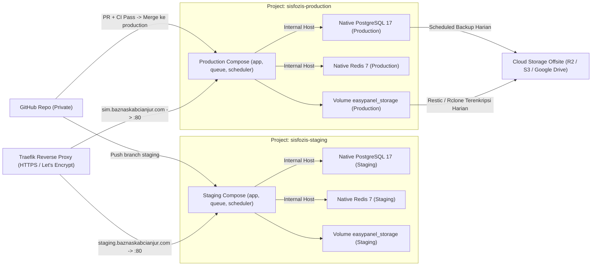

# Panduan Best Practice Deployment SISFOZIS BAZNAS Kabupaten Cianjur

Dokumen ini menjadi acuan standar untuk men-deploy, mengamankan, mem-backup, dan memelihara **SISFOZIS BAZNAS Kabupaten Cianjur** (Laravel 12 + Inertia React + FrankenPHP + PostgreSQL 17 + Redis 7) pada **1 VPS Easypanel** dengan dua lingkungan terpisah (**Staging** dan **Production**).

---

## 1. Arsitektur Target & Pemisahan Environment

Kedua lingkungan dijalankan pada **dua Project Easypanel yang terpisah** di VPS yang sama, masing-masing dengan **Native PostgreSQL 17**, **Native Redis 7**, dan volume penyimpanan privat terpisah:



> [!NOTE]
> Sesuai keputusan arsitektur **K6** (`docs/open-questions.md`), deployment saat ini berfokus pada VPS utama (Docker + FrankenPHP). Sinkronisasi dua arah dengan server lokal kantor berada di luar lingkup MVP dan dijadwalkan pada **Fase 4 (`P4-01`)**.

### Pembagian Komponen per Project

| Komponen | Project Staging (`sisfozis-staging`) | Project Production (`sisfozis-production`) |
|---|---|---|
| Branch Git | `staging` (auto-deploy) | `production` (auto-deploy setelah PR & CI lulus) |
| Domain contoh | `staging.baznaskabcianjur.com` | `sim.baznaskabcianjur.com` |
| Database | Native PostgreSQL 17 (`db`) | Native PostgreSQL 17 (`db`) |
| Cache / Session / Queue | Native Redis 7 (`redis`) | Native Redis 7 (`redis`) |
| Compose File | `docker-compose.easypanel.yml` | `docker-compose.easypanel.yml` |
| Service dalam Compose | `app`, `pkp-queue`, `pkp-scheduler` | `app`, `pkp-queue`, `pkp-scheduler` |
| `APP_ENV` & `APP_KEY` | `staging`, kunci khusus Staging | `production`, kunci khusus Production (berbeda!) |

---

## 2. Spesifikasi & Hardening VPS untuk Build Git Langsung

Karena **Staging dan Production berbagi 1 VPS** dan build Docker (`npm ci && npm run build` pada tahap Node serta `composer install` di `Dockerfile`) berjalan langsung di VPS, konfigurasi dasar server wajib menjaga agar proses build Staging tidak menghabiskan RAM/disk Production.

### Kebutuhan Resource Minimum
- **RAM:** minimal **4 GB** (sangat disarankan **8 GB** karena menjalankan Traefik, 2 instance PostgreSQL 17, 2 instance Redis 7, 6 container PHP/worker, dan proses `vite build`).
- **Disk:** minimal **60–80 GB NVMe/SSD** (layer cache Docker + backup lokal sementara + volume berkas PDF).
- **CPU:** minimal **2 vCPU** (disarankan **4 vCPU**).

### Tambah Swap 4 GB (Wajib untuk VPS 4 GB)
Jika VPS memakai RAM 4 GB, tambahkan swap agar kernel tidak membunuh proses Production (OOM Killer) saat Staging sedang menjalankan `npm run build`:

```bash
sudo fallocate -l 4G /swapfile
sudo chmod 600 /swapfile
sudo mkswap /swapfile
sudo swapon /swapfile
echo '/swapfile none swap sw 0 0' | sudo tee -a /etc/fstab
echo 'vm.swappiness=10' | sudo tee -a /etc/sysctl.conf
sudo sysctl -p
```

### Hardening Sistem Operasi & Disk
1. **Firewall UFW:** hanya buka port yang diperlukan (`22/tcp` SSH, `80/tcp` HTTP, `443/tcp` HTTPS, serta port dashboard Easypanel jika diperlukan sementara sebelum dipasangi domain). Jangan pernah membuka port `5432` PostgreSQL maupun port `6379` Redis ke publik.
   ```bash
   sudo ufw default deny incoming
   sudo ufw default allow outgoing
   sudo ufw allow 22/tcp
   sudo ufw allow 80/tcp
   sudo ufw allow 443/tcp
   sudo ufw enable
   ```
2. **SSH Key-Only:** nonaktifkan `PasswordAuthentication no` dan `PermitRootLogin prohibit-password` di `/etc/ssh/sshd_config`.
3. **Pembersihan Cache Build Berkala:** jadwalkan pembersihan image tidak terpakai dan build cache lama setiap minggu (misalnya lewat `crontab -e` pada host VPS setiap Minggu pukul `02:00` WIB) tanpa menghapus volume data:
   ```cron
   0 2 * * 0 docker builder prune --filter "until=168h" -f && docker image prune -f
   ```
   *(Jangan jalankan `docker system prune --volumes`, karena akan menghapus volume data jika container sempat berhenti.)*

---

## 3. Strategi Branching, CI Gatekeeper, & Auto-Deploy Webhook

### Alur Kerja Branch
1. Pengembangan fitur dilakukan di branch fitur (`feat/...` atau `fix/...`) atau di `master`.
2. Gabungkan perubahan ke **`staging`** → GitHub webhook memicu **auto-deploy ke Staging**.
3. Tim penguji / admin memverifikasi fitur, migrasi, ekspor PDF/Excel, dan alur RBAC di Staging.
4. Buat **Pull Request** dari `staging` (atau `master`) ke **`production`**.
5. Setelah CI GitHub Actions (**`linter`** dan **`tests`**) lulus dan PR di-merge ke **`production`**, GitHub webhook memicu **auto-deploy ke Production**.

### Membuat Branch `staging` dan `production` (Satu Kali di Awal)
Jalankan dari repositori lokal setelah commit terakhir sudah berada di `master`:

```bash
git checkout master
git pull origin master

git checkout -b staging
git push -u origin staging

git checkout -b production
git push -u origin production

git checkout master
```

### Aturan GitHub Branch Protection
Di GitHub (`Settings` → `Branches` → `Add branch ruleset` atau `Add rule`):
- Terapkan pada branch **`production`** (dan sangat disarankan juga pada **`staging`**):
  - Aktifkan **Require a pull request before merging**.
  - Aktifkan **Require status checks to pass before merging** dan pilih kedua job CI dari `.github/workflows/lint.yml` dan `.github/workflows/tests.yml`:
    - `quality` (Pint + ESLint + TypeScript check)
    - `ci` (Asset build + seluruh suite Pest terhadap PostgreSQL 17 + uji rollback migrasi)
  - Aktifkan **Block force pushes** dan nonaktifkan penghapusan branch.

### SSH Deploy Key untuk Private Repository
Karena repository bersifat private:
1. Di Easypanel Compose Service → tab **Source** → pilih **Git** → klik **Generate SSH Key** dan salin Public Key.
2. Di GitHub repository → **Settings** → **Deploy keys** → **Add deploy key** (centang *Allow write access* tetap **mati** / read-only).
3. Isi **Repository URL** dengan format SSH:
   ```text
   git@github.com:aditraanggra/sim-baznas.git
   ```
4. Anda dapat memakai satu Deploy Key yang sama atau Deploy Key berbeda untuk `sisfozis-staging` dan `sisfozis-production`.

### Mengaktifkan Auto-Deploy Webhook
1. Di masing-masing Compose Service Easypanel (`sisfozis-staging` untuk branch `staging`, dan `sisfozis-production` untuk branch `production`), buka pengaturan **Auto Deploy / Deploy Webhook** dan salin URL Webhook-nya.
2. Di GitHub repository → **Settings** → **Webhooks** → **Add webhook**:
   - **Payload URL:** tempel URL webhook Easypanel (bisa buat dua webhook atau menggunakan trigger push bawaan integrasi Easypanel).
   - **Content type:** `application/json`.
   - **Event:** *Just the `push` event*.
3. Easypanel memfilter deploy berdasarkan **Branch** yang dikonfigurasi pada masing-masing service Compose (`staging` vs `production`).

---

## 4. Panduan Setup Easypanel Langkah demi Langkah

Ulangi langkah berikut untuk masing-masing project: **`sisfozis-staging`** dan **`sisfozis-production`**.

### Langkah 1: Buat Project, Native PostgreSQL 17, & Native Redis 7
1. Di Easypanel, klik **Create Project** → beri nama `sisfozis-staging` (dan nanti `sisfozis-production`).
2. Di dalam project tersebut, klik **+ Service** → **Postgres**:
   - Beri nama service misalnya **`db`**, pilih versi image **`postgres:17-alpine`** (atau PostgreSQL 17), lalu klik **Create**.
   - Buka service `db` tersebut → tab **Credentials**, catat **Internal Host** (mis. `sisfozis-staging-db` / `sisfozis-production-db`), **Port** (`5432`), **Database**, **User**, dan **Password**.
3. Di dalam project yang sama, klik **+ Service** → **Redis**:
   - Beri nama service misalnya **`redis`**, pilih versi **`redis:7-alpine`** (atau Redis 7), lalu klik **Create**.
   - Buka service `redis` tersebut → tab **Credentials**, catat **Internal Host** (mis. `sisfozis-staging-redis` / `sisfozis-production-redis`), **Port** (`6379`), dan **Password**.

### Langkah 2: Buat Compose Service dari Git
1. Di dalam project yang sama, klik **+ Service** → **Compose**.
2. Pada bagian **Source**, pilih **Git**:
   - **Repository URL:** `git@github.com:aditraanggra/sim-baznas.git`
   - **Branch:** `staging` (untuk Staging) atau `production` (untuk Production)
   - **Build Path:** `/`
   - **Docker Compose File:** `docker-compose.easypanel.yml`
3. Klik **Save** (belum perlu Deploy sebelum mengisi Environment).

### Langkah 3: Isi Tab Environment
Buka tab **Environment** pada service Compose, lalu isi sesuai lingkungan (`Dockerfile` sudah menyertakan ekstensi `redis` / `phpredis`, dan `docker-compose.easypanel.yml` sudah menyetel `REDIS_CLIENT=phpredis`):

| Variabel | Staging (`sisfozis-staging`) | Production (`sisfozis-production`) | Keterangan |
|---|---|---|---|
| `APP_NAME` | `SISFOZIS BAZNAS Cianjur (Staging)` | `SISFOZIS BAZNAS Cianjur` | Nama aplikasi di header/tab |
| `APP_ENV` | `staging` | `production` | Mengaktifkan cache config/route/view/event |
| `APP_KEY` | `base64:<kunci-unik-staging>` | `base64:<kunci-unik-production>` | **Wajib berbeda** & simpan salinan aman! |
| `APP_DEBUG` | `false` | `false` | Jangan aktifkan `true` di server publik |
| `APP_URL` | `https://staging.baznaskabcianjur.com` | `https://sim.baznaskabcianjur.com` | Harus diawali `https://` |
| `APP_TIMEZONE` | `Asia/Jakarta` | `Asia/Jakarta` | Zona waktu WIB |
| `APP_LOCALE` | `id` | `id` | Bahasa aplikasi |
| `DB_HOST` | `sisfozis-staging-db` *(sesuai Credentials)* | `sisfozis-production-db` *(sesuai Credentials)* | Internal Host Native PostgreSQL |
| `DB_PORT` | `5432` | `5432` | Port internal Docker |
| `DB_DATABASE` | *(sesuai tab Credentials)* | *(sesuai tab Credentials)* | Nama database |
| `DB_USERNAME` | *(sesuai tab Credentials)* | *(sesuai tab Credentials)* | User database |
| `DB_PASSWORD` | *(sesuai tab Credentials)* | *(sesuai tab Credentials)* | Jika ada `$`, tulis ganda `$$` |
| `REDIS_HOST` | `sisfozis-staging-redis` *(sesuai Credentials)* | `sisfozis-production-redis` *(sesuai Credentials)* | Internal Host Native Redis |
| `REDIS_PORT` | `6379` | `6379` | Port internal Redis |
| `REDIS_PASSWORD` | *(sesuai tab Credentials)* | *(sesuai tab Credentials)* | Jika ada `$`, tulis ganda `$$` |
| `REDIS_DB` | `0` | `0` | DB Redis untuk session & queue |
| `REDIS_CACHE_DB` | `1` | `1` | DB terpisah agar `cache:clear` tidak menghapus sesi |
| `CACHE_STORE` | `redis` | `redis` | Driver cache Laravel |
| `SESSION_DRIVER` | `redis` | `redis` | Driver session Laravel |
| `SESSION_CONNECTION` | `default` | `default` | Mengarah ke `REDIS_DB=0` |
| `QUEUE_CONNECTION` | `redis` | `redis` | Driver antrean Laravel |
| `REDIS_QUEUE_RETRY_AFTER` | `120` | `120` | Harus `>` `--timeout=90` di `pkp-queue` |
| `SESSION_SECURE_COOKIE` | `true` | `true` | Set `false` hanya jika sementara tanpa HTTPS |
| `MAIL_MAILER` | `log` | `log` | Sesuai keputusan saat ini (tanpa SMTP luar) |
| `LOG_CHANNEL` | `stderr` | `stderr` | Agar log terbaca di panel Logs Easypanel |
| `LOG_LEVEL` | `info` | `warning` | Kurangi noise log di Production |
| `RUN_MIGRATIONS` | `true` | `true` | Menjalankan `migrate --force` saat container `app` start |
| `RUN_SEEDER` | `false` | `false` | Jalankan seeder manual sekali saja saat awal |
| `ADMIN_INITIAL_EMAIL` | `admin@baznaskabcianjur.com` | `admin@baznaskabcianjur.com` | Opsional hanya saat `db:seed` pertama kali |
| `ADMIN_INITIAL_USERNAME` | `admin` | `admin` | Opsional hanya saat `db:seed` pertama kali |
| `ADMIN_INITIAL_PASSWORD` | `<sandi-kuat-sementara>` | `<sandi-kuat-sementara>` | **Wajib dihapus setelah seed awal selesai** |

Klik **Save** setelah mengisi variabel.

> [!TIP]
> Cara generate `APP_KEY` baru langsung di mesin lokal:
> - PowerShell: `$b = New-Object byte[] 32; [System.Security.Cryptography.RandomNumberGenerator]::Create().GetBytes($b); "base64:" + [Convert]::ToBase64String($b)`
> - Linux/Mac: `echo "base64:$(openssl rand -base64 32)"`

### Langkah 4: Konfigurasi Domain & HTTPS
1. Buka tab **Domains** pada service Compose.
2. Tambahkan domain (mis. `sim.baznaskabcianjur.com`), arahkan ke service **`app`** port **`80`**, dan aktifkan **HTTPS** (Traefik / Let's Encrypt otomatis).
3. Dukungan reverse proxy HTTPS sudah tertanam di repo:
   - `docker/Caddyfile` meneruskan header proxy (`trusted_proxies static private_ranges`).
   - `bootstrap/app.php` mempercayai header `X-Forwarded-*` (`$middleware->trustProxies(at: '*')`).

### Langkah 5: Deploy & Inisialisasi Data Awal (Sekali Saja)
1. Klik **Deploy** dan pantau build log serta startup log service `app` sampai migrasi selesai dan status menjadi **Healthy**.
2. Pada deploy pertama saat database masih kosong, buka **Console** container **`app`** di Easypanel dan jalankan satu kali:
   ```bash
   php artisan db:seed --force
   ```
3. `PeranSeeder` kini aman dijalankan ulang (tidak akan mereset sandi jika sudah ada user ber-peran `admin`). Meski demikian, **hapus variabel `ADMIN_INITIAL_PASSWORD`** dari tab **Environment** segera setelah seed pertama selesai, lalu simpan.
4. Login pertama kali menggunakan akun admin awal, **segera ubah kata sandi**, dan **aktifkan 2FA TOTP**.

---

## 5. Keamanan Aplikasi, UU PDP, & Kredensial

### Perlindungan `APP_KEY` (Kritis)
Di SISFOZIS, `APP_KEY` bukan hanya untuk session cookie, tetapi juga kunci kriptografi untuk:
- **Enkripsi NIK** (`nik_encrypted` via Laravel `Crypt` + `nik_hash` HMAC-SHA256 sesuai **K11 / Q-11** dan UU PDP) pada data Muzakki dan Mustahik.
- **2FA TOTP** (`two_factor_secret` dan `two_factor_recovery_codes` dengan cast `encrypted` pada `app/Models/User.php`).

**Aturan wajib:**
- Simpan salinan `APP_KEY` Production secara aman di password manager resmi lembaga (terpisah dari VPS).
- **Jangan pernah mengganti `APP_KEY`** setelah data Production masuk, karena seluruh NIK dan secret 2FA yang sudah tersimpan tidak akan bisa didekripsi lagi.

### Wajib 2FA & Manajemen Sandi Tanpa SMTP
- Sistem mewajibkan **2FA TOTP (6 digit)** untuk peran `admin` dan `keuangan` (`User::wajib2Fa()` + middleware `PastikanDuaFaktor`).
- Karena `MAIL_MAILER=log` digunakan (belum ada server SMTP eksternal), fitur email *Lupa Kata Sandi* tidak mengirim email keluar ke kotak masuk pengguna.
- **SOP Operasional:** Jika ada amil atau pengurus UPZ lupa kata sandi atau kehilangan perangkat 2FA, Administrator melakukan reset kata sandi / penanganan akun langsung lewat menu **Administrasi Sistem → Pengguna** setelah verifikasi identitas internal.

### Keamanan Tautan Khusus Pimpinan & Isolasi Data
- **Portal Pimpinan & Arsip PKP** (`tautan_akses`) memakai token acak dengan hash SHA-256 dan header `noindex`. Bila perangkat pimpinan hilang atau pegawai berpindah tugas, **cabut tautan lama dan terbitkan tautan baru** dari panel Admin.
- **Larangan Salin Data Production ke Staging:** Jangan menyalin dump database Production mentah ke Staging karena memuat NIK, data KTP/berkas mustahik, dan secret 2FA. Di Staging cukup gunakan data seeder atau data uji sintetis.

---

## 6. Strategi Backup 3-2-1 & Uji Restore

Terapkan prinsip **3-2-1**: minimal 3 salinan data (1 aktif di VPS, 1 backup DB/storage terkelola, 1 salinan offsite terenkripsi di luar VPS/region lain).

> [!NOTE]
> Data pada **Native Redis 7** bersifat sementara (*ephemeral*: cache, sesi aktif, dan antrean berjalan) sehingga tidak perlu di-backup ke offsite. Pekerjaan antrean yang gagal tetap tercatat permanen pada tabel PostgreSQL `failed_jobs`, dan pemisahan `REDIS_DB=0` (session/queue) dengan `REDIS_CACHE_DB=1` (cache) menjaga sesi pengguna aman saat `php artisan cache:clear` dijalankan.

### 1. Backup Database PostgreSQL (Native Easypanel)
1. Buka service Native PostgreSQL **`db`** di project **`sisfozis-production`**.
2. Masuk ke tab **Backups** → hubungkan **Backup Destination** offsite (disarankan **Cloudflare R2** atau **Amazon S3** atau **Google Drive**).
3. Aktifkan **Scheduled Backup** harian (misalnya pukul `01:00` WIB — di luar jam kerja BAZNAS).
4. Simpan retensi minimal: **7 backup harian**, **4 backup mingguan**, dan **3 backup bulanan**.

### 2. Backup Berkas Privat (`storage/app/private`)
Backup PostgreSQL **tidak** mencakup volume `easypanel_storage` tempat lampiran KTP/permohonan mustahik, SK UPZ, surat, dan PDF arsip disimpan (`storage/app/private`).

Gunakan **Restic** (terenkripsi client-side & deduplikasi) dari host VPS untuk mem-backup volume storage Production setiap hari ke bucket R2/S3 yang sama (prefix terpisah):

1. Cari path mountpoint volume Production di host VPS:
   ```bash
   docker volume ls | grep easypanel_storage
   docker volume inspect <nama_volume_production_easypanel_storage> --format '{{ .Mountpoint }}'
   ```
2. Inisialisasi repositori Restic terenkripsi (contoh ke Cloudflare R2 / S3):
   ```bash
   export AWS_ACCESS_KEY_ID="<r2-access-key>"
   export AWS_SECRET_ACCESS_KEY="<r2-secret-key>"
   export RESTIC_REPOSITORY="s3:https://<account-id>.r2.cloudflarestorage.com/<bucket-backup>/sisfozis-storage"
   export RESTIC_PASSWORD="<kunci-enkripsi-restic-simpan-di-vault>"

   restic init
   ```
3. Pasang skrip backup harian di host VPS (mis. `/usr/local/sbin/backup-sisfozis-storage.sh`, dijalankan via cron root pukul `01:30` WIB):
   ```bash
   #!/usr/bin/env bash
   set -euo pipefail
   source /etc/sisfozis-backup.env

   MOUNTPOINT="$(docker volume inspect <nama_volume_production_easypanel_storage> --format '{{ .Mountpoint }}')"
   restic backup "$MOUNTPOINT" --tag sisfozis-production
   restic forget --keep-daily 7 --keep-weekly 4 --keep-monthly 6 --prune
   ```
   *(Simpan `/etc/sisfozis-backup.env` dengan izin `chmod 600` dan catat `RESTIC_PASSWORD` bersama `APP_KEY` di password manager lembaga — tanpa keduanya, backup storage tidak dapat dibuka.)*

### 3. Uji Restore Triwulanan (Wajib)
Backup yang belum pernah diuji restore dianggap belum aman. Lakukan simulasi restore minimal **3 bulan sekali** ke lingkungan uji terpisah (atau instance sementara):
1. Restore snapshot PostgreSQL terbaru ke DB uji sementara.
2. Restore volume `easypanel_storage` via `restic restore latest --target /tmp/restore-test`.
3. Jalankan container uji dengan **`APP_KEY` Production** (hanya di mesin/jaringan tertutup tanpa webhook dan tanpa expose publik, lalu hapus setelah selesai).
4. Verifikasi:
   - Login admin & validasi 2FA berfungsi.
   - Halaman daftar Muzakki/Mustahik dapat membuka dan mendeteksi NIK terenkripsi (`nik_encrypted`).
   - Lampiran privat (`/berkas/...`) dan PDF Arsip PKP dapat diunduh utuh.

---

## 7. Pemantauan, Migrasi Aman, Rollback, & Checklist Go-Live

### Pemantauan Operasional
- **Healthcheck Aplikasi:** endpoint `/up` diperiksa otomatis oleh Docker setiap 15 detik (`docker-compose.easypanel.yml`). Pastikan status `app`, `pkp-queue`, dan `pkp-scheduler` selalu **Running / Healthy** di Easypanel.
- **Antrean Pekerjaan (`pkp-queue`):** periksa berkala via Console container `app`:
  ```bash
  php artisan queue:failed
  ```
  Jika ada job gagal setelah perbaikan bug, jalankan `php artisan queue:retry all`.
- **Scheduler (`pkp-scheduler`):** memantau `php artisan schedule:work` di tab Logs service `pkp-scheduler`; pastikan tugas `upz:peringatan-sk` berjalan setiap hari pukul `07:00` WIB (`routes/console.php`).
- **Uptime Eksternal:** pasang pemantau uptime eksternal (mis. Uptime Kuma / Better Stack) menembak `https://sim.baznaskabcianjur.com/up` setiap 1–5 menit dengan alert ke Telegram/WhatsApp tim IT.

### Aturan Migrasi Database Aman
- Seluruh migrasi wajib dapat di-rollback (sudah diverifikasi otomatis di CI `.github/workflows/tests.yml` lewat `migrate:fresh && migrate:rollback`).
- **Sebelum merge PR ke branch `production` yang berisi migrasi baru:**
  1. Pastikan migrasi sudah teruji di **Staging**.
  2. Buat **manual snapshot / backup** di tab **Backups** Native PostgreSQL Production.
  3. Hindari mengubah/menghapus kolom aktif dalam satu kali deploy (lakukan pola *expand & contract*: tambah kolom baru dulu, migrasi data, baru hapus kolom lama di rilis berikutnya).
  4. Patuhi aturan PRD: tanpa *hard delete* pada data RKAT, realisasi, dan transaksi keuangan/penyaluran.

### Prosedur Rollback Darurat
1. **Jika hanya bug kode aplikasi (tanpa perubahan skema destruktif):**
   ```bash
   git checkout production
   git revert <commit-bermasalah>
   git push origin production
   ```
   Auto-deploy Easypanel akan mem-build ulang versi sebelumnya secara otomatis.
2. **Jika bug disertai migrasi skema yang perlu dibatalkan:**
   - Hentikan sementara service `app`, `pkp-queue`, `pkp-scheduler` di Easypanel (atau aktifkan maintenance mode).
   - **Pulihkan snapshot PostgreSQL** yang diambil sesaat sebelum deploy via Easypanel DB Backups.
   - `git revert` commit pada branch `production` dan push agar Easypanel men-deploy versi stabil sebelumnya.

### Checklist Sebelum Go-Live Production
- [ ] Swap 4 GB & UFW firewall aktif di VPS; port `5432` dan `6379` tidak terbuka ke internet.
- [ ] Branch `staging` dan `production` aktif beserta **GitHub Branch Protection** (`quality` & `ci` wajib lulus).
- [ ] Project `sisfozis-production` terpisah dari `sisfozis-staging` (DB, Redis, volume, domain, dan `APP_KEY` terpisah).
- [ ] `APP_DEBUG=false`, `APP_ENV=production`, `APP_URL=https://...`, `SESSION_SECURE_COOKIE=true`, `LOG_CHANNEL=stderr`.
- [ ] Koneksi Native PostgreSQL 17 dan Native Redis 7 aktif (uji login, session, cache, serta antrean `queue:work` berjalan tanpa error).
- [ ] `APP_KEY` Production dan `RESTIC_PASSWORD` tersimpan aman di password manager resmi lembaga.
- [ ] `php artisan db:seed --force` sudah dijalankan sekali dan **`ADMIN_INITIAL_PASSWORD` sudah dihapus** dari tab Environment.
- [ ] Sandi admin awal sudah diganti, akun awal tim per bidang sudah dibuat, dan **2FA TOTP aktif** untuk seluruh akun `admin` & `keuangan`.
- [ ] Scheduled Backup Native PostgreSQL + backup Restic `easypanel_storage` sudah berjalan ke offsite storage dan minimal 1x uji restore berhasil.
- [ ] Endpoint `https://sim.baznaskabcianjur.com/up`, login, cetak PDF kwitansi/disposisi, unggah & unduh berkas privat, serta halaman lacak publik sudah diverifikasi end-to-end.
